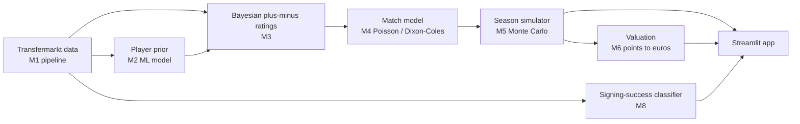

<div align="center">

# ⚽ FreeAgent

### Buying Points, Not Names

**Pricing football transfers in expected league points, and forecasting the 2026/27 season before a ball is kicked.**


*AIML Capstone Project*

### 🔴 [**Live app → freeagent-ai.streamlit.app**](https://freeagent-ai.streamlit.app/)

</div>

---

## What it does

Clubs pay for names. FreeAgent asks a different question: **how many league points does this signing add to this club, and is the fee worth it?**

| | Feature | What you get |
| --- | --- | --- |
| 📈 | **Forecast 2026/27** | Title, top-4, top-half and relegation probabilities for every club in the top-five leagues (5,000 simulated seasons). |
| 🆕 | **Summer 2026 signings** | Each new signing judged before he has played: *Best Buy*, *Fair* or *Overpaid*, with an honest "too close to call" when the evidence is thin. |
| 🧪 | **Transfer Lab** | Pick any player, any club and a fee. See how many points he adds and whether the price is justified. |
| 🏁 | **Track record** | The same method run blind on seasons 2019–2025, each predicted only from earlier data, then checked against what really happened. |

> The 2026/27 forecast can only be scored in May 2027. Every accuracy number below comes from the blind **track record** on past seasons.

---

## Results (blind, walk-forward, no peeking)

| Question | Result | Script |
| --- | --- | --- |
| Is a club in the **top or bottom half** this season? (680 club-seasons) | **77.1%** (95% CI 73.8–80.1%), points error 8.6 vs 9.2 for last season's points | `scripts/season_predict.py` |
| Same, with the promoted-club rule used for 2026/27 | **77.4%**, points error 8.6 | `scripts/season_predict.py --promoted relegated` |
| Will a €5M+ signing become a **regular starter**? (all signings) | **64.2%** (base rate 51.4%) | `scripts/m8_signing_success.py` |
| Same, only when the model is confident (p ≥ 0.6 or ≤ 0.4) | **71.1%** on 60.4% of signings | `scripts/m8_signing_success.py` |
| Match model: player ratings + Elo vs Elo alone (log loss) | **0.9930 vs 0.9960**, significantly better | `scripts/rq1_match_backtest.py` |
| Player model with ML prior vs without (log loss) | **1.0013 vs 1.0035**, significantly better | `scripts/m2_prior_backtest.py` |

### A bias we found and fixed

The first version compared a new signing against the *average* player in the squad, so signings by elite clubs were called "Overpaid" **46%** of the time. In v2 the signing displaces the *weakest* player in his position, and the squad reflects who left and arrived that summer. Overpaid verdicts for the strongest quarter of clubs fell from **46% → 6%**.

### Honest limitations

- The **per-signing points estimate is not independently validated**: the on/off reality check (M7) found no significant link (−0.042, 95% CI −0.136 to +0.052) and has low statistical power. Treat verdicts as informed estimates, not facts.
- Season forecasts are **tied with strong baselines** on top-half accuracy; the gain is mainly in points error.
- Promoted clubs have no second-division data, so each gets the average strength of the clubs they replaced.
- The data snapshot (July 2026) misses late-window transfers.
- Photos exist for the 132 of 400 looked-up players that have a freely licensed image; the rest show initials.

---

## How it works



| Module | File | State |
| --- | --- | --- |
| M1 Data pipeline | `src/freeagent/data.py` | Done, tested |
| M2 ML prior | `src/freeagent/prior.py` | Done, tested, real-data results |
| M3 Bayesian plus-minus | `src/freeagent/impact.py` | Done, tested |
| M4 Match model + baselines | `src/freeagent/match.py` | Done, tested, real-data results |
| M5 Season simulator | `src/freeagent/simulate.py` | Done, tested, run on real data |
| M6 Valuation | `src/freeagent/value.py` | Done, tested, run on real data |
| M7 Validation | `scripts/m7_validate_verdicts.py` | Done (no detectable link, low power) |
| M8 Signing-success classifier | `src/freeagent/success.py` | Done, tested, real-data results |

`src/freeagent/synthetic.py` builds a fake football world in the real data's format where every player's true rating is known. Tests use it to check that the models recover the truth.

---

## Quick start

```bash
git clone https://github.com/freeagent-ai/freeagent.git
cd freeagent
pip install -r requirements.txt
streamlit run app.py
```

The app only reads the files in `reports/`, so it starts instantly and **needs no raw data**.

```bash
python tests/run_tests.py     # all tests, works without pytest
pytest                        # if pytest is installed
```

<details>
<summary><b>Re-run the models (needs the raw data)</b></summary>

Put `freeagent_subset.zip` in `data/` (built by `prepare_subset.py` from the Kaggle dataset
*Football Data from Transfermarkt*). Raw data is never committed.

```bash
# Match model and prior
python scripts/rq1_match_backtest.py --synthetic   # quick check on fake data
python scripts/rq1_match_backtest.py               # real data
python scripts/m2_prior_backtest.py                # ~4 min

# Signing success (M8) and model comparison
python scripts/m8_signing_success.py               # ~1 min
python scripts/m8_improve.py                       # ~2 min
python scripts/m8_compare.py                       # 11 model families, with significance tests
python scripts/robustness_checks.py                # label threshold, position, rating half-life

# Season forecast backtest
python scripts/season_predict.py                   # top half / bottom half before the season
python scripts/season_points_test.py               # points forecast vs last season's points
python scripts/value_rise.py                       # will market value rise in 12 months?

# Valuation and validation
python scripts/m5_points_per_signing.py            # ~7 min (method v2; --method v1 for comparison)
python scripts/m6_shuffle_test.py                  # do verdicts depend on more than the fee?
python scripts/m7_validate_verdicts.py             # ~1 min

# The live 2026/27 forecast
python scripts/forecast_2026.py                    # ~14 min, writes forecast_2026_*.csv and lab_*.csv

# App extras (once)
python scripts/export_app_extras.py                # club names, player countries
python scripts/fetch_player_photos.py              # needs internet; freely licensed photos
```

All results use frozen settings (ridge strength 100, rating half-life 1,460 days) and the package versions in `requirements.txt` (full list in `requirements-lock.txt`).

</details>

---

## Repository layout

```
app.py             Streamlit app: one scrolling page, five sections
src/freeagent/     one file per module (see table above)
scripts/           every experiment, runnable on its own
tests/             tests for every module (54)
reports/           every number and figure used in the report
data/              input data (not in git)
```

---

## Team

| Name |
| --- |
| Om Prabhat |
| Prakhar Sinha |
| Prakhyath V |
| Mohit Soni |

---

## Data, credits and licences

- **Data:** Kaggle *Football Data from Transfermarkt*; top-five European leagues. Raw files are not redistributed here.
- **Player photos:** freely licensed images from Wikimedia Commons. The author and licence appear next to each photo in the app and are stored in `reports/player_photos.csv`.
- **Flags:** flagcdn. No league or club logos are used (they are trademarks).
- **Fonts:** Unbounded, JetBrains Mono and Manrope from Google Fonts.

*Educational project. Not betting or financial advice.*
